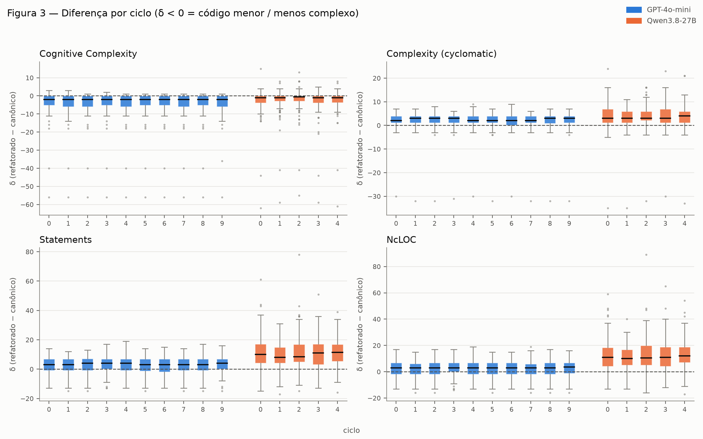
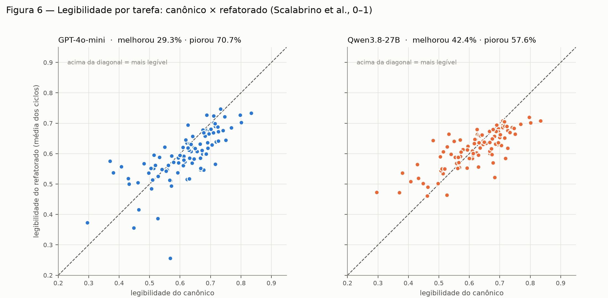
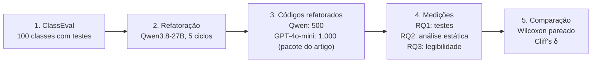

# Refatoração com LLM aberto: Qwen3.8-27B × GPT-4o-mini

Este repositório replica o estudo *"From Human to Machine Refactoring: Assessing GPT-4's Impact on Python Class Quality and Readability"* (Midolo, Tramontana e Di Penta, [arXiv 2601.13139](https://arxiv.org/abs/2601.13139)), trocando o GPT pelo **Qwen3.8-27B**, um modelo de pesos abertos acessado pela API da Groq. O objetivo é verificar se um modelo aberto alcança resultados comparáveis aos do GPT em correção, qualidade estática e legibilidade.


-EB6834)
-555)

---

## Sumário

- [Visão geral](#visão-geral)
- [Principais resultados](#principais-resultados)
- [Metodologia](#metodologia)
- [Estrutura do repositório](#estrutura-do-repositório)
- [Como reproduzir](#como-reproduzir)
- [Resultados por pergunta](#resultados-por-pergunta)
- [Limitações](#limitações)

---

## Visão geral

O artigo original pediu ao GPT para refatorar as **100 classes Python do benchmark [ClassEval](https://github.com/FudanSELab/ClassEval)**, usando um prompt com **29 refatorações do catálogo de Fowler**. Cada classe foi refatorada várias vezes (ciclos), porque a resposta de um LLM muda a cada execução.

Repetimos o mesmo experimento com um modelo aberto e comparamos os dois com **as mesmas ferramentas**:

| | GPT-4o-mini | Qwen3.8-27B |
|---|---|---|
| **Tipo** | fechado (OpenAI) | pesos abertos |
| **Gerações** | 100 classes × 10 ciclos = 1.000 | 100 classes × 5 ciclos = 500 |
| **De onde vêm** | pacote de replicação dos autores (Zenodo) | gerados por nós, via Groq |
| **Parâmetros** | não publicados | `temperature=1.0`, `top_p=1.0`, `max_tokens=4000` |

> O texto do artigo diz "GPT-4o", mas o pacote de replicação mostra que o modelo usado foi o `gpt-4o-mini-2024-07-18`. Por isso o chamamos de GPT-4o-mini.

As três perguntas de pesquisa são as mesmas do artigo:

| | Pergunta | Medição | Resultado esperado |
|---|---|---|---|
| **RQ1** · Correção | O código refatorado continua funcionando? | testes do ClassEval | passar em todos os testes |
| **RQ2** · Qualidade | A qualidade estática melhora? | Flake8, Pylint, Lizard e complexidade cognitiva | menos avisos e menos complexidade |
| **RQ3** · Legibilidade | O código fica mais fácil de ler? | modelo de Scalabrino et al. (nota de 0 a 1) | nota maior que a do original |

---

## Principais resultados

> Nenhum dos modelos é superior em todas as medidas. O GPT-4o-mini é mais confiável numa única tentativa e gera menos código novo. O Qwen3.8-27B acerta com várias tentativas e preserva melhor a legibilidade, mas gera código maior e com mais avisos.

| | Medida | GPT-4o-mini | Qwen3.8-27B | Melhor |
|---|---|---:|---:|:---:|
| **RQ1** | Classes que passam em todos os testes, por ciclo | **86,3%** | 63,5% | GPT-4o-mini |
| **RQ1** | pass@5 (passa em pelo menos 1 de 5 ciclos) | 89,8% | **93,9%** | Qwen3.8-27B |
| **RQ1** | Consistency (passa nos 5 ciclos) | **83,7%** | 24,5% | GPT-4o-mini |
| **RQ2** | Complexidade cognitiva, variação média | **−4,12** | −3,01 | GPT-4o-mini |
| **RQ2** | Linhas de código (NcLOC), variação média | **+2,58** | +12,43 | GPT-4o-mini |
| **RQ2** | Avisos do Flake8, variação média | **+0,615** | +1,946 | GPT-4o-mini |
| **RQ2** | Avisos do Pylint, variação média | **+0,044** | +0,542 | GPT-4o-mini |
| **RQ3** | Nota de legibilidade, variação média | −0,024 | **−0,003** | Qwen3.8-27B |

<sub>RQ1: 98 classes (sem `ClassEval_17` e `ClassEval_48`, que falham até no código original) e ciclos 0–4 nos dois modelos. RQ2 e RQ3: variação = refatorado − original, média por classe. Nas medidas com teste estatístico (Wilcoxon pareado por classe), a diferença entre os modelos é significativa (p < 0,01). Tabela completa: [`results/comparison/comparison_table.md`](results/comparison/comparison_table.md).</sub>

### Síntese

1. **Correção (RQ1):** em uma única tentativa, o GPT-4o-mini preserva o comportamento em mais classes. Considerando 5 tentativas, o Qwen3.8-27B cobre mais classes, porém com baixa consistência: apenas 24,5% passam nos 5 ciclos.
2. **Qualidade (RQ2):** os dois modelos dividem métodos longos em métodos menores (*Extract Method*), o que reduz a complexidade cognitiva e aumenta a complexidade ciclomática e o tamanho do código. O aumento é maior no Qwen3.8-27B.
3. **Legibilidade (RQ3):** o GPT-4o-mini reduz a nota de legibilidade de forma significativa (p < 0,0001); a variação do Qwen3.8-27B não é significativa (p = 0,344).

<table>
<tr>
<td width="50%"><br><sub><b>Figura 3.</b> Variação de complexidade e tamanho por ciclo (δ &lt; 0 = diminuiu).</sub></td>
<td width="50%"><br><sub><b>Figura 6.</b> Legibilidade por classe: abaixo da diagonal, a nota piorou.</sub></td>
</tr>
</table>

---

## Metodologia



1. As 100 classes do ClassEval são a entrada, cada uma com seus testes.
2. O Qwen3.8-27B recebe cada classe com o prompt do artigo e devolve a versão refatorada, cinco vezes por classe.
3. Os códigos do Qwen se juntam aos 1.000 códigos do GPT-4o-mini publicados pelos autores.
4. Os dois conjuntos passam pelas mesmas ferramentas de medição.
5. Cada métrica é comparada entre o código original e o refatorado, e entre os dois modelos.

### Validação do pipeline

Antes da comparação, os scripts foram aplicados aos dados do GPT-4o-mini para confirmar que reproduzem os números do artigo.

| Item | Resultado |
|---|---|
| RQ1 (Tabela 3) | Mean TPR 0,844, pass@10 0,890 e Consistency 0,800, iguais ao artigo |
| Flake8 | contagens por categoria idênticas nos 1.000 códigos do GPT |
| NcLOC | 100% igual aos valores do pacote |
| Legibilidade | notas idênticas em 99/99 classes originais e 990/990 códigos do GPT |
| RQ3 (Tabela 4) | médias, intervalos de confiança e tamanho de efeito reproduzidos |
| Complexidade | sem acesso ao SonarCloud, calculada com Lizard, `cognitive_complexity` e `ast` |

---

## Estrutura do repositório

| Caminho | O que tem |
|---|---|
| [`src/`](src/) | configuração, lista de refatorações (Tabela 1), prompt (Seção 3.2), parser, executor de testes e funções compartilhadas de estatística, análise estática e legibilidade |
| [`scripts/`](scripts/) | os passos do pipeline, numerados na ordem de execução (tabela abaixo) |
| [`results/qwen3.8-27b/`](results/qwen3.8-27b/) | gerações do Qwen (`raw/`, `parsed.jsonl`), resultados dos testes, Tabelas 2 e 3, Figura 1 e análise do caso de falha |
| [`results/rq2/`](results/rq2/) | RQ2: métricas, Figuras 3 e 4, exemplos e [README](results/rq2/README.md) |
| [`results/rq3/`](results/rq3/) | RQ3: Tabela 4, Figura 6, exemplos e [README](results/rq3/README.md) |
| [`results/comparison/`](results/comparison/) | comparação GPT-4o-mini × Qwen e limitações ([README](results/comparison/README.md)) |
| `data/` | ClassEval e o pacote de replicação do artigo (baixados pelos scripts; o pacote não é versionado) |

| Script | Etapa | O que faz |
|---|---|---|
| `00_check_environment.py` | setup | verifica dependências e faz uma chamada de teste ao modelo |
| `01_download_classeval.py` | dados | baixa o ClassEval (100 classes + testes) |
| `02_generate_refactorings.py` | geração | refatora as classes via Groq (retomável) |
| `03_parse_and_stats.py` | geração | extrai código e refatorações; Tabela 2 e Figura 1 |
| `04_run_tests.py` | RQ1 | roda os testes (`--canonical` testa o ambiente) |
| `05_rq1_metrics.py` | RQ1 | Tabela 3: Mean/Std TPR, pass@k, Consistency |
| `06_failure_cases.py` | RQ1 | candidatos a falha semântica (Figura 2) |
| `07_get_gpt_package.py` | dados | baixa o pacote do artigo (códigos do GPT e `rsm.jar`) |
| `08_static_analysis.py` | RQ2 | Flake8, Pylint, tamanho e complexidade |
| `09_rq2_stats.py` | RQ2 | estatística, Figuras 3 e 4, exemplo da Figura 5 |
| `10_readability.py` | RQ3 | legibilidade com o modelo de Scalabrino et al. |
| `11_rq3_stats.py` | RQ3 | Tabela 4, Figura 6, exemplo da Figura 7 |
| `12_comparison.py` | comparação | GPT-4o-mini × Qwen nas três perguntas |

---

## Como reproduzir

> As gerações do Qwen e os resultados dos testes já estão no repositório. Para reproduzir apenas as análises da RQ2, da RQ3 e da comparação, que não exigem chave de API, vá direto ao [passo 5](#5-rq2-rq3-e-comparação).

> Os scripts executam código gerado por LLM. Rode em um ambiente isolado (venv, WSL ou Docker), não em uma máquina com dados sensíveis.

### 1. Ambiente

Requer **Python 3.10+** (testado em 3.12) e **Java** no PATH (só para a RQ3).

```bash
python -m venv .venv
source .venv/bin/activate          # Windows: .venv\Scripts\activate
pip install -r requirements.txt
```

<sub>`numpy<2` é proposital: os testes do ClassEval usam `np.mat`, removido no NumPy 2.</sub>

### 2. Chave e modelo

```bash
cp .env.example .env               # edite e coloque a sua GROQ_API_KEY
python scripts/00_check_environment.py
```

O código usa o SDK `openai` apontando para a API compatível da Groq. Valores principais do `.env`: `LLM_PROVIDER=groq`, `LLM_MODEL=qwen/qwen3.8-27b` e `N_RUNS` (número de ciclos; o experimento deste repositório usou **5**).

<details>
<summary><b>Erros comuns e o modelo de raciocínio</b></summary>

- O `00_check_environment.py` retorna 404 para ID de modelo errado, 401 para chave inválida e 429 para limite atingido.
- O Qwen3.8 é um modelo de raciocínio híbrido. O parser ignora blocos `<think>...</think>`. Se `usage.reasoning_tokens` em `results/<modelo>/raw/*.json` for alto, use `LLM_REASONING_EFFORT=none` no `.env` (se a API recusar com HTTP 400, remova a opção).
- Outros provedores: `LLM_PROVIDER=sambanova|fireworks` (veja o fim do `.env.example`).

</details>

<details>
<summary><b>Limites do plano gratuito da Groq e quantos ciclos cabem</b></summary>

Limites do `qwen/qwen3.8-27b` no plano gratuito (confirme em console.groq.com/settings/limits): 30 requisições/min, 1.000 requisições/dia, 8.000 tokens/min e **200.000 tokens/dia**. O gargalo é a cota diária de tokens.

```bash
python scripts/02_generate_refactorings.py --plan --days 3     # calcula quantos ciclos cabem
```

- Depois de 5 gerações reais, o `--plan` passa a usar os tokens **medidos**.
- A conta também tem limite de tokens de saída por minuto (`OTPM_LIMIT`). O script controla o ritmo sozinho para não receber erro 429.
- Se o pedido de uma classe grande nunca couber no limite por minuto, a geração é pulada, conta como falha (`skipped_rate_limit`) e pode ser excluída com `05_rq1_metrics.py --exclude-skipped` (declarando isso).
- Com menos de 10 ciclos, o pass@10 fica `n/a` e o desvio padrão do TPR usa menos pontos: é uma réplica reduzida do protocolo do artigo.

</details>

### 3. Dados e teste do ambiente

```bash
python scripts/01_download_classeval.py
python scripts/04_run_tests.py --canonical --repeats 5
```

O segundo comando roda o **código original** contra os testes. Algumas classes falham por causa do benchmark ou do ambiente, **não do modelo**:

| Classe | Motivo |
|---|---|
| `ClassEval_17` | o teste depende da data atual |
| `ClassEval_48` | hostname fixo no teste |
| `ClassEval_31`, `ClassEval_51` | precisão de ponto flutuante |
| `ClassEval_50` | espera erro de permissão (como root, o arquivo é gravável) |
| `ClassEval_58` | aleatório: falha às vezes mesmo no original |

### 4. Gerar as refatorações e rodar a RQ1

```bash
python scripts/02_generate_refactorings.py --tasks 3 --runs 2       # teste rápido
python scripts/02_generate_refactorings.py --auto-resume            # experimento completo
python scripts/03_parse_and_stats.py                                # Tabela 2 e Figura 1
python scripts/04_run_tests.py                                      # testes de todas as gerações
python scripts/05_rq1_metrics.py --exclude-canonical-failures       # Tabela 3
python scripts/06_failure_cases.py --top 5                          # candidatos a falha semântica
```

<details>
<summary><b>Detalhes da geração e das métricas da RQ1</b></summary>

- **Prompt:** prompt de sistema = Seção 3.2 do artigo com as 29 refatorações da Tabela 1; prompt de usuário = código da classe. Configuração completa em [`experiment_config.json`](results/qwen3.8-27b/experiment_config.json).
- **Ordem ciclo a ciclo:** a qualquer momento há ciclos completos, e os passos 03–05 rodam com resultados parciais.
- **Retomável:** com `--auto-resume`, o script espera o reset da cota diária e continua. Em Windows, use WSL; no Linux, `nohup`, `tmux` ou `screen`. Para testar sem API, use `LLM_MODEL=mock`.
- **Refatorações:** cada tipo conta uma vez por geração. A lista é a **declarada** pelo modelo, não verificada no código.
- **Mean/Std TPR:** em cada ciclo, a fração das classes que passam em todos os testes; média e desvio padrão entre os ciclos.
- **pass@k:** estimador não viesado de Chen et al. (2021). Com n ciclos, pass@1 = Mean TPR.
- **Consistency:** fração das classes que passam em todos os ciclos.
- Gerações sem código extraível contam como **falha** (`no_code`).

</details>

### 5. RQ2, RQ3 e comparação

Não precisam da API nem rodam os testes de novo: usam `parsed.jsonl` e `test_results.jsonl`.

```bash
python scripts/07_get_gpt_package.py     # pacote do artigo (Zenodo 10.5281/zenodo.17533631, CC-BY 4.0)
python scripts/08_static_analysis.py     # RQ2: métricas (~3 min)
python scripts/09_rq2_stats.py           # RQ2: tabelas, Figuras 3 e 4, exemplos
python scripts/10_readability.py         # RQ3: precisa de Java (~9 min)
python scripts/11_rq3_stats.py           # RQ3: Tabela 4, Figura 6, exemplos
python scripts/12_comparison.py          # comparação GPT-4o-mini × Qwen (RQ1–RQ3)
```

<sub>Os scripts gravam só `task_id` e `iteration` nos CSV; nenhum caminho local é salvo.</sub>

---

## Resultados por pergunta

| | Onde ler | Destaques |
|---|---|---|
| **RQ1** | [`rq1_failure_case_analysis.md`](results/qwen3.8-27b/rq1_failure_case_analysis.md) | `ClassEval_62`: o Qwen "corrige" um bug que o teste esperava e muda o comportamento |
| **RQ2** | [`results/rq2/README.md`](results/rq2/README.md) | `ClassEval_57`: avisos do Flake8 caem de 21 para 10 e do Pylint de 23 para 12 |
| **RQ3** | [`results/rq3/README.md`](results/rq3/README.md) | `ClassEval_64`: correto, mas a nota cai de 0,73 para 0,52 |
| **Comparação** | [`results/comparison/README.md`](results/comparison/README.md) | método, tabela completa e problemas encontrados nos dados do artigo |

> Refazendo as contas com os dados publicados, encontramos pontos que mudam a leitura de alguns números do artigo, como as contagens de Pylint do código original zeradas por um bug no script dos autores e o p = 1,000 da RQ3, que vem de um teste só na direção de melhora. Os detalhes estão nos READMEs da [RQ2](results/rq2/README.md), da [RQ3](results/rq3/README.md) e da [comparação](results/comparison/README.md).

---

## Limitações

| Desenho da réplica | Medições | Generalização |
|---|---|---|
| 5 ciclos no Qwen e 10 no GPT: pass@10 do Qwen = n/a | testes do GPT rodados pelos autores; os do Qwen, pelo grupo | só o ClassEval: 100 classes pequenas e autocontidas |
| Qwen de 27B comparado ao gpt-4o-mini, não ao GPT-4o | complexidade sem SonarCloud | o benchmark é público e pode estar nos dados de treino |
| a Groq não fixa a versão do modelo | modelo de legibilidade treinado em Java, usado em Python (como no artigo) | um único modelo aberto e um único prompt |

Lista completa em [`results/comparison/README.md`](results/comparison/README.md).
